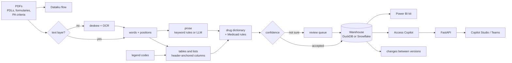

# PDLwatch Overview

[](https://github.com/faizanreza-cs/pdlwatch/actions/workflows/ci.yml)


**Know the day a state changes your brand's Medicaid coverage, with the page that proves it.**

A drug maker's market access team needs to know, for each brand and each state Medicaid program:
is it preferred, does it need prior authorization, step therapy or a quantity limit, and what
changed this quarter? The answers sit in PDFs that every state formats its own way: ruled
tables, preferred / non-preferred lists with footnote symbols, tiered managed care formularies,
prior authorization criteria written as prose, and scans with no text layer at all.

This repo turns 100+ of those PDFs into one table automatically. Every row cites its document
and page and carries a confidence score; rows the pipeline isn't sure about go to a review queue
with the reason, and consecutive versions of a state's list are compared to report what changed.

Real PDLs come with no answer key, so the repo generates one: **106 PDFs for 50 states and DC**
in four layouts, 15 of them rendered as scans, with a second quarterly version for 25 states and
**260 known changes**. Every status in them is fictional and every page says so. Rules and
thresholds were set on 25 "dev" states; the numbers below come from the other 26. A manual
workflow runs the same pipeline on real state PDLs.

## What it found

| Question | How | Result (26 held-out states: 56 PDFs, 6,218 rows) |
|---|---|---|
| Can tables and lists be read with no one checking? | Columns found from header word positions, each state's legend codes, a dictionary of 193 drugs | Ruled tables, preferred / non-preferred lists and tiered formularies: **all 4,708 rows found and fully correct**, all accepted automatically |
| And prior authorization prose? | Keyword rules offline; an LLM with structured output when a key is set | All 594 drugs found, but the keyword rules get the status right for only 71%, so **every prose row goes to a reviewer** |
| And scanned PDFs? | OCR after straightening the page; empty cells re-read; anything uncertain to review | 96% of rows found; 45% accepted automatically, **2 of those 404 wrong** |
| How safe is automatic acceptance? | Confidence score with named review reasons, threshold set on the dev states | 82% of all rows accepted automatically, **2 of 5,112 wrong (0.04%)** |
| What changed this quarter? | Consecutive PDLs compared per state | All 25 states with two versions: **95% of the 260 true changes found; 193 confirmed automatically, all correct**; the rest wait for review |
| How fast? | 4 worker processes | All 106 PDFs, 317 pages (47 OCR'd), in 75 seconds |


The numbers are honest about where the work is: tables and lists go straight through, while
prose and damaged scans go to a person, with the reason attached ([review queue](#the-review-queue)).

## The documents


Each state Medicaid program publishes a **preferred drug list (PDL)**, updated quarterly or after
each Pharmacy & Therapeutics committee meeting:

- **Preferred** drugs can be dispensed without prior authorization (PA); **non-preferred** drugs
  need it. A preferred drug can still carry **step therapy** (try other drugs first) or a
  **quantity limit** ("4 per 28 days").
- Supplemental rebates sometimes make a **brand preferred over its generic**.
- Managed care and CHIP formularies use **tiers** (tier 1 preferred generic, tier 2 preferred
  brand, tier 3 non-preferred), and some drugs are **not covered** at all (for example
  anti-obesity drugs in many states).
- **Prior authorization criteria** documents say the same things in sentences: "Members new to
  therapy must try Eliquis and Xarelto before Savaysa is approved."

The corpus has all of these, written the way real lists vary: state-specific codes ("CC",
"BvG", "*", "†", "Non-PDL", "T3"), legends at the top, classes running across pages, wrapped drug
names, markers on their own line, landscape pages, and scans with tilt, noise and blur.

## How a PDF becomes rows

1. **Read the page.** Words and their positions come from the text layer. A page without one is
   straightened (the angle with the sharpest line profile) and OCR'd at 300 dpi.
2. **Find the table.** A line of header words ("Drug Name | Status | PA | QL", "PREFERRED AGENTS |
   NON-PREFERRED AGENTS", "Medication | Drug Tier | Coverage Requirements") sets the columns, and
   words below are placed by position. Headers that wrap onto two lines, headers OCR damaged,
   tables that continue onto the next page and names that wrap are handled.
3. **Read the legend.** Each document's own codes: "CC = clinical criteria required", "Tier 3 =
   non-preferred", "BvG = brand preferred over generic".
4. **Match the drug** to the dictionary: brands, generics and combinations, with the OCR
   confusions (rn/m, l/1, 0/o) folded and a fuzzy match within the therapeutic class.
5. **Apply the rules.** Non-preferred means prior authorization. A field the document doesn't
   express stays unknown instead of becoming "no".
6. **Read the prose** with keyword rules offline, or with an LLM: structured output, every drug
   it returns must appear on the page and in the dictionary, and its reading is compared with the
   rules' (disagreements go to review).
7. **Score.** Each row starts at 1.0 and loses confidence for named reasons; below 0.75 it goes to
   review.
8. **Load and compare.** All rows go to the warehouse; each state's latest PDL, accepted rows
   only, becomes the `drug_access` table, and consecutive versions become `changes`.

## The review queue

Every row that isn't accepted says why. Across all 106 PDFs:

| Reason | Rows | What it catches |
|---|---|---|
| Read from prose by keyword rules | 1,563 | Every prose row, until an LLM reads it |
| Status not readable | 650 | Prose that names a drug without a status the rules can read (428), and scanned status cells OCR couldn't read (222) |
| Marker unreadable in the scan (ST, QL, PA) | 462 | The legend defines a symbol the scan lost, so a missing symbol proves nothing |
| Low OCR confidence | 216 | Words Tesseract wasn't sure of |
| Footnote symbol read by OCR | 105 | † and ‡ that came back as letters ("Zituviot") |
| Text beside the name unreadable in the scan | 65 | "Nicotrol inhaler (nicotine) aL": probably a mangled "QL" |
| Status cell re-read from the scan | 72 | A status found only by re-reading an empty cell on its own |
| Status code not in the legend | 44 | A scan reading "NP" as "NF" (non-formulary) |
| PA, QL or ST cell unreadable | 74 | "Ne" or "bes" in a Yes / No column |

A row can have more than one reason. `pdlwatch review --out review.csv` writes the queue with
the source page and line for a reviewer to work through.

## What the table looks like


```
$ pdlwatch drug Ozempic
state state_name product        status tier    pa    st    ql     ql_detail  effective             source
   AK     Alaska Ozempic     preferred       True False  True               2026-07-01 AK-PDL-2026-07 p.1
   AL    Alabama Ozempic non_preferred       True False  True               2026-10-01 AL-PDL-2026-10 p.1
   AR   Arkansas Ozempic     preferred      False False False               2026-07-01 AR-PDL-2026-07 p.1
   AZ    Arizona Ozempic non_preferred       True False  True 4 per 28 days 2026-10-01 AZ-PDL-2026-10 p.1
...
```

Changes are found the same way for each state with two versions: status flips, additions,
removals and quantity limits. 149 of the 159 status changes were found correctly. A change
involving a scanned version always waits for review, because a drug OCR missed looks exactly
like a removal.

## Ask it

The **Access Copilot** is an LLM agent over the warehouse with 11 tools (a drug's access by
state, a state's list, a class landscape, comparisons, changes, the review queue, extraction
quality, saved queries and guarded SQL). Every status in an answer comes from a tool and cites
its document and page.

```bash
pdlwatch ask "Which states prefer Mounjaro?"
pdlwatch ask "What changed in the Texas PDL since the last version?"
pdlwatch ask "Which states put a brand ahead of its generic?"
```

It runs offline with a deterministic keyword router by default, or with Anthropic, OpenAI or
Azure OpenAI.

## What's inside

| Part | What it does | Tech |
|---|---|---|
| Synthetic corpus (`synth/`) | 106 PDLs and PA criteria PDFs for 51 jurisdictions, with the truth for every row and change; scans with tilt, noise and blur | reportlab, Pillow |
| PDF reader (`pdf.py`) | Words, lines and phrases from the text layer, or from OCR after deskewing | pdfplumber, Tesseract |
| Extraction (`extract/`) | Header-anchored tables and lists, legends, prose rules, LLM extraction with grounding, confidence and review reasons | Python, rapidfuzz, LLM APIs |
| Drug dictionary (`drugs.py`) | 193 products in 20 therapeutic classes, aliases, OCR-tolerant matching | rapidfuzz |
| Evaluation (`evaluate.py`, `changes.py`) | Row recall and precision, field accuracy, accepted error rate by layout and for scans; change detection against the truth | pandas |
| Warehouse and saved queries (`warehouse.py`, `sql/`) | Seven tables; state scorecard, class landscape, brand over generic, quarterly changes, review backlog, extraction by document | Snowflake SQL, run locally on DuckDB via sqlglot |
| Access Copilot (`agent/`) | Tool-using agent that cites document and page | Anthropic, OpenAI, Azure OpenAI, or offline mock |
| API (`api.py`) | `/drugs`, `/states`, `/classes`, `/changes`, `/review`, `/documents`, `/metrics`, `/queries`, `POST /extract` for one uploaded PDF, `POST /ask` | FastAPI |
| Real PDLs (`realdata.py`, `audit.py`, `sources/`) | Polite downloader for public state PDLs, and an audit printout to check rows against their source line | httpx |
| Power BI kit (`powerbi/`) | Star-schema export, DAX measures, theme, page guide | Power BI |
| Dataiku kit (`dataiku/`) | Flow from a folder of PDFs to the tables, with SQL recipes | Dataiku |
| Copilot Studio (`copilot/`, `docs/copilot-studio.md`) | OpenAPI connector so a Copilot Studio agent can call the Access Copilot | Microsoft Copilot Studio |



## Quickstart

```bash
git clone https://github.com/faizanreza-cs/pdlwatch && cd pdlwatch
make setup                                      # OCR also needs the tesseract binary
make build                                      # generate the corpus, extract it, score it
pdlwatch drug semaglutide                      # every semaglutide product, every state
pdlwatch state Ohio --class GLP-1              # one state's list for one class
pdlwatch changes --state TX                    # what changed between versions
pdlwatch review --out review.csv               # the review queue, with sources
pdlwatch extract path/to/pdl.pdf --out rows.csv   # any PDL or PA criteria PDF
PDLWATCH_DB=data/mine.duckdb pdlwatch extract path/to/folder/   # a folder into its own warehouse
make api                                        # http://localhost:8000/docs
```

To use a real model for the Copilot and for prose pages (`pdlwatch build --llm`):

```bash
export PDLWATCH_PROVIDER=anthropic ANTHROPIC_API_KEY=... PDLWATCH_MODEL=<model id>
# or PDLWATCH_PROVIDER=azure AZURE_OPENAI_ENDPOINT=... AZURE_OPENAI_API_KEY=... PDLWATCH_MODEL=<deployment>
# or PDLWATCH_PROVIDER=openai OPENAI_API_KEY=... PDLWATCH_MODEL=<model id>
```

Or with Docker: `docker build -t pdlwatch . && docker run -p 8000:8000 pdlwatch`.

## Real state PDLs

[`sources/medicaid_pdls.yaml`](sources/medicaid_pdls.yaml) lists 38 public PDL and formulary
PDFs or pages from 20 states (Colorado, Florida, Illinois, Iowa, Maryland, Mississippi, Ohio,
Oregon, Texas and others), including several past versions per state for change detection.
`pdlwatch sync` downloads them politely (robots.txt honoured, one request per second per host,
a User-Agent that names the project, PDFs only) and runs the same extraction. There's no truth
to score against, so `pdlwatch audit` prints a random sample of accepted rows beside the line
and header they were read from, to check by eye.

It runs as a manual GitHub Actions workflow (**Actions > Real data (state Medicaid PDLs) > Run
workflow**), which
prints the results and the audit sample in the log and keeps them as an artifact. State sites
rename files every quarter; a link that fails is reported in the log as a line to update.

## Snowflake

All SQL is written in Snowflake's dialect. CI runs every query on DuckDB through sqlglot's
translation; on Snowflake the same files run unchanged.

1. Run [`snowflake/setup.sql`](snowflake/setup.sql). It creates a warehouse, a database, a loader
   role and a **read-only analyst role** for the agent, API, Power BI and Dataiku.
2. `pip install "pdlwatch[snowflake]"`, set `SNOWFLAKE_ACCOUNT`, `SNOWFLAKE_USER`,
   `SNOWFLAKE_PASSWORD` (or `SNOWFLAKE_PRIVATE_KEY_FILE`), `SNOWFLAKE_ROLE=PDLWATCH_LOADER` and
   `SNOWFLAKE_WAREHOUSE=PDLWATCH_WH`, then run `pdlwatch load`.
3. Switch to the analyst role and `PDLWATCH_BACKEND=snowflake`. Saved queries, `pdlwatch sql`,
   the API and the agent then run against Snowflake.

## Power BI, Dataiku and Copilot Studio

- **Power BI:** `pdlwatch export-powerbi` writes the star schema to `powerbi/data/`.
  [`powerbi/README.md`](powerbi/README.md) lists the relationships and the pages (drug access
  map, class landscape, quarterly changes, review and quality), the DAX measures
  ([`measures.dax`](powerbi/measures.dax)) and the theme ([`theme.json`](powerbi/theme.json)).
- **Dataiku:** [`dataiku/README.md`](dataiku/README.md) gives the flow: a managed folder of
  PDFs, one Python recipe that extracts them, SQL recipes for the reports, and a scenario that
  emails the access team when a new version changes something. The recipe is a thin wrapper
  around the tested library.
- **Copilot Studio:** [`docs/copilot-studio.md`](docs/copilot-studio.md) adds the Access Copilot
  and the drug, state and change lookups to a Copilot Studio agent through a custom connector
  ([`copilot/access-copilot.swagger.json`](copilot/access-copilot.swagger.json)), so the field
  and access teams can ask in Teams.

## Guardrails

- **Nothing uncertain is accepted silently.** Unreadable cells, symbols a scan lost, codes the
  legend doesn't define, re-read cells and prose all go to review with the reason. On a scan, an
  unreadable cell stays unknown instead of becoming "no".
- **Every row cites its source:** document, page and the line it was read from.
- **LLM output is checked, not trusted:** a drug must appear on the page and in the dictionary
  (anything else is counted as rejected), and the model's reading is compared with the rules'.
- **Model-written SQL** must be one read-only SELECT on the known tables; file and table
  functions are blocked, rows are capped and a query stops after 30 seconds. DuckDB opens
  read-only with external access disabled; on Snowflake the agent uses the read-only role.
- **The API is read-only** apart from `POST /extract`, which reads one PDF (up to 20 MB and 60
  pages) and stores nothing. It can require a key (`PDLWATCH_API_TOKEN`, `X-API-Key` header);
  the LLM provider is set by the server, never by the caller.

## Tests and evals

- **114 tests**, all offline:
  - Table and list parsing on hand-built pages: wrapped cells, two-line headers, unknown
    columns, markers on their own line, headers OCR damaged, and drugs the dictionary doesn't
    know (a row is never mistaken for a header, a generic is never glued to the drug above).
  - Legends, markers, Medicaid rules, the review reasons for scans, prose rules, change
    detection, drug matching and OCR folds.
  - The pipeline end to end on a small corpus (one PDF per layout, a version pair and a scan),
    with thresholds per layout, OCR with deskew, and a broken PDF that is reported while the
    rest are extracted.
  - The agent's routing, tools and SQL guard, the providers and structured outputs with fake
    clients, the LLM extractor's grounding and agreement checks, the API (uploads included), and
    the downloader against a fake server (robots.txt, missing files, HTML instead of PDF).
  - The Power BI measures against the exported columns, the connector against the API, the
    Dataiku recipe against the library, every saved query, and the charts.
- **Agent eval** (`make eval`): 21 golden questions with the expected tool and the facts each
  answer must contain, read from the warehouse at eval time. The offline mock passes 21/21, which
  checks the tools and routing; `make eval-llm` scores a real model on the same questions.

## Limitations

- **The synthetic PDFs are cleaner than real ones.** Four renderers can't cover every state's
  layout: real lists have merged cells, rotated tables and footnotes in many styles. The
  real-data workflow and its audit sample are where that shows.
- **Prose needs the LLM path.** The keyword rules find every drug but get only 71% of prose
  statuses right, so all prose rows go to review. The LLM extractor is built and tested with
  fake clients, but wasn't run here (no API key in this environment).
- **Scans:** about half of scanned rows go to review. A scan can also drop a footnote symbol
  without a trace; that is how the 2 wrong accepted rows on the test states lost their PA and QL
  flags.
- **The drug dictionary is hand-built** (193 products in 20 classes). Production use would map to
  RxNorm or NDC codes.
- **Not run in CI:** the Snowflake loader, the Dataiku recipe, the Power BI report and the LLM
  path. They use the same tested code and SQL.

```
pdlwatch/
  synth/            corpus generator with ground truth (truth, prose, render, corpus)
  pdf.py            words, lines and phrases from the text layer or OCR
  extract/          layout (tables, lists), legend, rows (rules, scoring), prose, llm, document
  drugs.py          drug dictionary and matching
  evaluate.py       extraction metrics against the truth
  changes.py        changes between versions
  pipeline.py       build -> warehouse + results.json
  warehouse.py      DuckDB / Snowflake backends
  sql/*.sql         saved queries (Snowflake SQL)
  agent/            Access Copilot: providers, tools, SQL guard, loop
  evals/            golden questions + runner
  realdata.py · audit.py · api.py · cli.py · charts.py · powerbi.py
sources/  powerbi/  dataiku/  copilot/  snowflake/  docs/
```

## Need this for your team?

I build document AI and analytics for pharma market access and commercial teams: PDF
extraction pipelines, payer coverage tracking, and AI assistants grounded in your data.

**Faizan Reza**, AI engineer · [GitHub](https://github.com/faizanreza-cs) · faizanreza01@gmail.com

## License

Apache License 2.0 ([`LICENSE`](LICENSE), [`NOTICE`](NOTICE)). Every status in the synthetic
corpus is fictional, and every synthetic page says so. Real PDLs are public documents published
by state Medicaid agencies; this project isn't affiliated with any of them, and extracted
statuses aren't coverage advice: check the source document.
