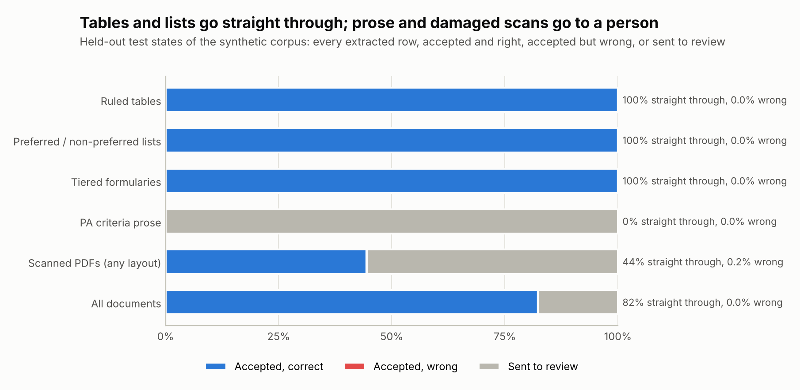
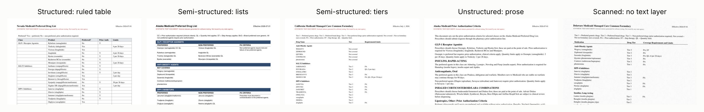
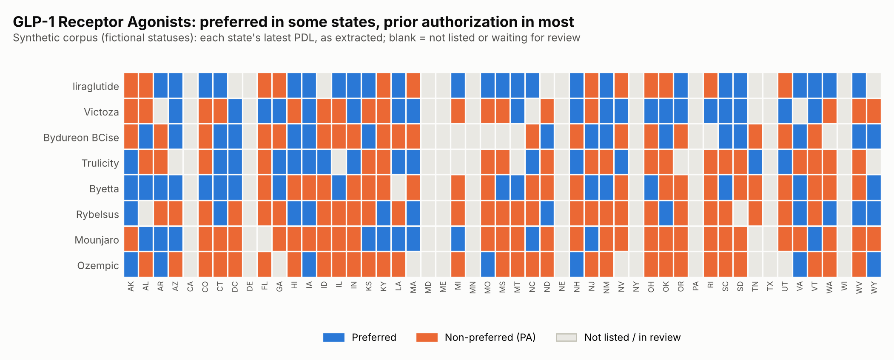
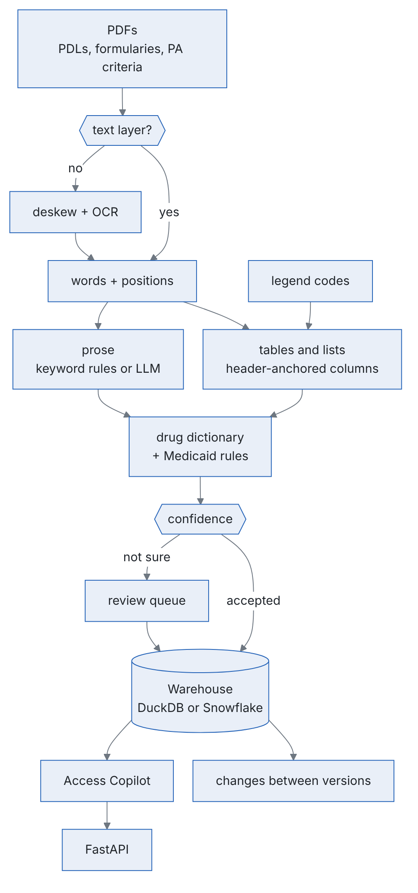

<div align="center">

<picture>
  <source media="(prefers-color-scheme: dark)" srcset="docs/img/logo-dark.svg">
  
</picture>

<p><em>State Medicaid preferred drug lists, read from PDFs and tracked over time.</em></p>

[](https://github.com/faizanreza-cs/pdlwatch/actions/workflows/ci.yml)


[](https://www.linkedin.com/in/faizanreza)
[](https://x.com/cs_faizan)

</div>

## ⚡ Overview

A drug maker's market access team needs to know, for each brand and each state Medicaid program:
is it preferred, does it need prior authorization, step therapy or a quantity limit, and what
changed this quarter? The answers sit in PDFs that every state formats its own way: ruled
tables, preferred / non-preferred lists with footnote symbols, tiered managed care formularies,
prior authorization criteria written as prose, and scans with no text layer at all.

This repo turns 100+ of those PDFs into one table automatically. Every row cites its document
and page and carries a confidence score; rows the pipeline isn't sure about go to a review queue
with the reason, and consecutive versions of a state's list are compared to report what changed.

Real PDLs come with no answer key, so the repo generates one: **106 PDFs for 50 states and DC**
in four layouts, 15 of them rendered as scans, with a second quarterly version for 25 states and
**260 known changes**. Every status in them is fictional and every page says so. Rules and
thresholds were set on 25 "dev" states; the numbers below come from the other 26. A manual
workflow runs the same pipeline on real state PDLs.

## What it found

| Question | How | Result (26 held-out states: 56 PDFs, 6,218 rows) |
|---|---|---|
| Can tables and lists be read with no one checking? | Columns found from header word positions, each state's legend codes, a dictionary of 193 drugs | Ruled tables, preferred / non-preferred lists and tiered formularies: **all 4,708 rows found and fully correct**, all accepted automatically |
| And prior authorization prose? | Keyword rules offline; an LLM with structured output when a key is set | All 594 drugs found, but the keyword rules get the status right for only 71%, so **every prose row goes to a reviewer** |
| And scanned PDFs? | OCR after straightening the page; empty cells re-read; anything uncertain to review | 96% of rows found; 45% accepted automatically, **2 of those 404 wrong** |
| How safe is automatic acceptance? | Confidence score with named review reasons, threshold set on the dev states | 82% of all rows accepted automatically, **2 of 5,112 wrong (0.04%)** |
| What changed this quarter? | Consecutive PDLs compared per state | All 25 states with two versions: **95% of the 260 true changes found; 193 confirmed automatically, all correct**; the rest wait for review |
| How fast? | 4 worker processes | All 106 PDFs, 317 pages (47 OCR'd), in 80 seconds |

On real state PDLs there's no answer key, so accepted rows are checked by sampling. On 26 public
files from 13 states (24 PDFs and Washington's weekly Excel lists), **49% of 52,110 rows were
accepted automatically, and the status was right in all 60 accepted rows drawn at random**; the
rest wait for review with a reason ([results](#results)).



The numbers are honest about where the work is: tables and lists go straight through, while
prose and damaged scans go to a person, with the reason attached ([review queue](#the-review-queue)).

## The documents



Each state Medicaid program publishes a **preferred drug list (PDL)**, updated quarterly or after
each Pharmacy & Therapeutics committee meeting:

- **Preferred** drugs can be dispensed without prior authorization (PA); **non-preferred** drugs
  need it. A preferred drug can still carry **step therapy** (try other drugs first) or a
  **quantity limit** ("4 per 28 days").
- Supplemental rebates sometimes make a **brand preferred over its generic**.
- Managed care and CHIP formularies use **tiers** (tier 1 preferred generic, tier 2 preferred
  brand, tier 3 non-preferred), and some drugs are **not covered** at all (for example
  anti-obesity drugs in many states).
- **Prior authorization criteria** documents say the same things in sentences: "Members new to
  therapy must try Eliquis and Xarelto before Savaysa is approved."

The corpus has all of these, written the way real lists vary: state-specific codes ("CC",
"BvG", "*", "†", "Non-PDL", "T3"), legends at the top, classes running across pages, wrapped drug
names, markers on their own line, landscape pages, and scans with tilt, noise and blur.

## How a PDF becomes rows

1. **Read the page.** Words and their positions come from the text layer. A page without one is
   straightened (the angle with the sharpest line profile) and OCR'd at 300 dpi.
2. **Find the table.** A line of header words ("Drug Name | Status | PA | QL", "PREFERRED AGENTS |
   NON-PREFERRED AGENTS", "Medication | Drug Tier | Coverage Requirements") sets the columns, and
   words below are placed by position. Headers that wrap onto two lines, headers OCR damaged,
   tables that continue onto the next page and names that wrap are handled.
3. **Read the legend.** Each document's own codes: "CC = clinical criteria required", "Tier 3 =
   non-preferred", "BvG = brand preferred over generic".
4. **Match the drug** to the dictionary: brands, generics and combinations, with the OCR
   confusions (rn/m, l/1, 0/o) folded and a fuzzy match within the therapeutic class.
5. **Apply the rules.** Non-preferred means prior authorization. A field the document doesn't
   express stays unknown instead of becoming "no".
6. **Read the prose** with keyword rules offline, or with an LLM: structured output, every drug
   it returns must appear on the page and in the dictionary, and its reading is compared with the
   rules' (disagreements go to review).
7. **Score.** Each row starts at 1.0 and loses confidence for named reasons; below 0.75 it goes to
   review.
8. **Load and compare.** All rows go to the warehouse; each state's latest PDL, accepted rows
   only, becomes the `drug_access` table, and consecutive versions become `changes`.

## The review queue

Every row that isn't accepted says why. Across all 106 PDFs:

| Reason | Rows | What it catches |
|---|---|---|
| Read from prose by keyword rules | 1,563 | Every prose row, until an LLM reads it |
| Status not readable | 650 | Prose that names a drug without a status the rules can read (428), and scanned status cells OCR couldn't read (222) |
| Marker unreadable in the scan (ST, QL, PA) | 462 | The legend defines a symbol the scan lost, so a missing symbol proves nothing |
| Low OCR confidence | 216 | Words Tesseract wasn't sure of |
| Footnote symbol read by OCR | 105 | † and ‡ that came back as letters ("Zituviot") |
| Text beside the name unreadable in the scan | 65 | "Nicotrol inhaler (nicotine) aL": probably a mangled "QL" |
| Status cell re-read from the scan | 72 | A status found only by re-reading an empty cell on its own |
| Status code not in the legend | 44 | A scan reading "NP" as "NF" (non-formulary) |
| PA, QL or ST cell unreadable | 74 | "Ne" or "bes" in a Yes / No column |

A row can have more than one reason. `pdlwatch review --out review.csv` writes the queue with
the source page and line for a reviewer to work through, and a `decision` column for each row:
`accept` (right as read), `correct` (with the corrected status, PA, ST, QL or product) or
`reject` (a note or header, not a drug). `pdlwatch review --apply review.csv --reviewer NAME`
checks the file and appends the decisions to a log next to the warehouse; a file with any bad
line records nothing. Every build and sync applies the latest decision for each row, so a
decision made once holds on every run after it.

A decision belongs to what the row was read from: the text of its page, the position of its line
and the name as printed. The same PDF read again, or a re-saved copy, keeps its decisions; a
page that changed sends its rows back for review. `results.json` then reports, for each review
reason, how many decisions a reviewer made and how many corrected or rejected the row: the
measured error rate behind each reason. Decisions on accepted rows (an audit) measure the error
rate of automatic acceptance the same way.

## What the table looks like



```
$ pdlwatch drug Ozempic
state state_name product        status tier    pa    st    ql     ql_detail  effective             source
   AK     Alaska Ozempic     preferred       True False  True               2026-07-01 AK-PDL-2026-07 p.1
   AL    Alabama Ozempic non_preferred       True False  True               2026-10-01 AL-PDL-2026-10 p.1
   AR   Arkansas Ozempic     preferred      False False False               2026-07-01 AR-PDL-2026-07 p.1
   AZ    Arizona Ozempic non_preferred       True False  True 4 per 28 days 2026-10-01 AZ-PDL-2026-10 p.1
...
```

Changes are found the same way for each state with two versions: status flips, additions,
removals and quantity limits. 149 of the 159 status changes were found correctly. A change
involving a scanned version always waits for review, because a drug OCR missed looks exactly
like a removal.

## Ask it

The **Access Copilot** is an LLM agent over the warehouse with 11 tools (a drug's access by
state, a state's list, a class landscape, comparisons, changes, the review queue, extraction
quality, saved queries and guarded SQL). Every status in an answer comes from a tool and cites
its document and page.

```bash
pdlwatch ask "Which states prefer Mounjaro?"
pdlwatch ask "What changed in the Texas PDL since the last version?"
pdlwatch ask "Which states put a brand ahead of its generic?"
```

It runs offline with a deterministic keyword router by default, or with Anthropic, OpenAI or
Azure OpenAI.

## What's inside

| Part | What it does | Tech |
|---|---|---|
| Synthetic corpus (`synth/`) | 106 PDLs and PA criteria PDFs for 51 jurisdictions, with the truth for every row and change; scans with tilt, noise and blur | reportlab, Pillow |
| PDF and spreadsheet reader (`pdf.py`, `sheet.py`) | Words, lines and phrases from the text layer, or from OCR after deskewing; a list published as Excel or CSV becomes rows at fixed column positions, read by the same table parser, through a source profile (the columns to read, the rows to keep) when it needs one | pdfplumber, Tesseract, openpyxl |
| Extraction (`extract/`) | Header-anchored tables and lists, legends, prose rules, LLM extraction with grounding, confidence and review reasons | Python, rapidfuzz, LLM APIs |
| Drug dictionary (`drugs.py`, `rxnorm.py`) | 193 products in 20 therapeutic classes, aliases, OCR-tolerant matching; names outside it are matched to RxNorm's ingredient and brand names | rapidfuzz, RxNorm |
| Evaluation (`evaluate.py`, `changes.py`) | Row recall and precision, field accuracy, accepted error rate by layout and for scans; change detection against the truth | pandas |
| History (`history.py`) | Each drug's status in force on any date, one interval per PDL version, with its source | pandas |
| Review (`review.py`) | Reviewer decisions (accept, correct, reject) from a CSV, kept in an append-only log, applied on every run; the error rate behind each review reason | pandas |
| Alerts (`alerts.py`, `watchlists/`) | The changes a team watches (brands, ingredients, classes, states), rated high, medium or info, in a digest that keeps unconfirmed changes apart; sent once to a Slack or Teams webhook | Python |
| Warehouse and saved queries (`warehouse.py`, `sql/`) | Seven tables; state scorecard, class landscape, brand over generic, quarterly changes, review backlog, extraction by document | Snowflake SQL, run locally on DuckDB via sqlglot |
| Access Copilot (`agent/`) | Tool-using agent that cites document and page | Anthropic, OpenAI, Azure OpenAI, or offline mock |
| API (`api.py`) | `/drugs`, `/states`, `/classes`, `/changes`, `/review`, `/documents`, `/metrics`, `/queries`, `POST /extract` for one uploaded PDF, `POST /ask`; a key per customer and an access log | FastAPI |
| Real PDLs (`realdata.py`, `cache.py`, `audit.py`, `sources/`) | Polite downloader that keeps every version by content and fetches only what changed, an extraction cache so a run only extracts new PDFs, an audit printout to check rows against their source line, and `pdlwatch inspect` to see how a page is read | httpx |

<p align="center">
<picture>
  <source media="(prefers-color-scheme: dark)" srcset="docs/img/pipeline-dark.png">
  
</picture>
</p>

## Quickstart

```bash
git clone https://github.com/faizanreza-cs/pdlwatch && cd pdlwatch
make setup                                      # OCR also needs the tesseract binary
make build                                      # generate the corpus, extract it, score it
pdlwatch drug semaglutide                      # every semaglutide product, every state
pdlwatch drug Ozempic --as-of 2026-08-15       # the status in force on a date
pdlwatch state Ohio --class GLP-1              # one state's list for one class
pdlwatch changes --state TX                    # what changed between versions
pdlwatch alerts --watchlist watchlists/example.yaml   # the changes a team watches, rated
pdlwatch review --out review.csv               # the review queue, with sources
pdlwatch review --apply review.csv --reviewer Faizan   # decisions that hold on every run after
pdlwatch extract path/to/pdl.pdf --out rows.csv   # a PDL or PA criteria PDF, or an Excel/CSV list
PDLWATCH_DB=data/mine.duckdb pdlwatch extract path/to/folder/   # a folder into its own warehouse
make api                                        # http://localhost:8000/docs
```

To use a real model for the Copilot and for prose pages (`pdlwatch build --llm`):

```bash
export PDLWATCH_PROVIDER=anthropic ANTHROPIC_API_KEY=... PDLWATCH_MODEL=<model id>
# or PDLWATCH_PROVIDER=azure AZURE_OPENAI_ENDPOINT=... AZURE_OPENAI_API_KEY=... PDLWATCH_MODEL=<deployment>
# or PDLWATCH_PROVIDER=openai OPENAI_API_KEY=... PDLWATCH_MODEL=<model id>
```

Or with Docker: `docker build -t pdlwatch . && docker run -p 8000:8000 pdlwatch`.

## Real state PDLs

[`sources/medicaid_pdls.yaml`](sources/medicaid_pdls.yaml) lists 41 public PDL and formulary
files or pages from 20 states, including past versions for change detection.
`pdlwatch sync` downloads them politely (robots.txt honoured, one request per second per host,
a User-Agent that names the project, PDFs and spreadsheets only) and runs the same extraction.
Files are kept by content, so a new version posted under the same address sits beside the old
one, and the next sync asks each server whether a file changed before downloading it. There's no truth to score
against, so `pdlwatch audit` prints a random sample of accepted rows beside the line and header
they were read from, to check by eye, and `pdlwatch inspect` shows how any page is read.

It runs as a GitHub Actions workflow every morning, and on demand (**Actions > Real data (state
Medicaid PDLs) > Run workflow**). Each run prints the results, a sample of the review queue and the
audit sample in the log, and keeps the archive and the extraction cache for the next run (as an
artifact, for 90 days). State sites rename files every quarter; a link that fails is reported in
the log as a line to update.

### Results

From run [38713818631](https://github.com/faizanreza-cs/PDLwatch/actions/runs/38713818631)
(15 October 2026): **26 files from 13 states (24 PDFs with a text layer, 2,292 pages, and
Washington's two latest weekly workbooks): 52,110 rows, 25,439 (49%) accepted automatically.**
60 accepted rows drawn at random were checked by eye against their line and column header: the
status was right in all 60, and so were the PA and quantity limit flags printed on those lines.
An earlier sample found one wrong row. New York
ends its PDL with a criteria table ("Drug / Class Name | Step Therapy (ST) Parameters | ..."),
which had been read as the list above it. Tables like it are now recognised, and New York's
accepted rows fell from 669 to 604.

| State | Files | Latest version | Rows | Accepted | Layout |
|---|---|---|---|---|---|
| Florida | 3 | Oct 2026 | 4,333 | 1,251 | Product table without a status column (every product listed is preferred), with a PA column |
| Georgia | 1 | Oct 2026 | 1,503 | 389 | A managed care plan's formulary: two tables side by side, read left then right. Names and tiers over several lines still go to review |
| Illinois | 3 | Oct 2025 | 12,421 | 5,458 | Table with centred headers at the very top of the page |
| Indiana | 1 | Aug 2026 | 1,202 | 686 | Bulleted lists with step therapy and quantity limit notes |
| Kentucky | 2 | May 2024 | 3,899 | 1,963 | Three lists: preferred, preferred with PA, non-preferred |
| Maryland | 2 | Jul 2026 | 2,229 | 1,543 | Lists with "cc" and "ql" codes |
| New York | 1 | Sep 2026 | 1,091 | 604 | Lists with superscripts and coverage notes, then a criteria table |
| Ohio | 2 | Jul 2026 | 2,434 | 1,562 | Lists with PA, ST and brand-over-generic codes |
| Oregon | 3 | Jan 2025 | 1,996 | 916 | One preferred column (name and form), symbols defined at the foot of each page |
| Pennsylvania | 2 | Jan 2026 | 4,590 | 2,319 | Preferred / non-preferred lists with superscript PA, QL and age codes that the text layer joins to the name ("CapsuleQL") |
| Vermont | 3 | Oct 2026 | 6,474 | 3,059 | Lists with criteria and quantity limit notes |
| Washington | 2 | Oct 2026 | 8,013 | 4,631 | A weekly Excel workbook with one row per package (about 126,000), read through a source profile: the drugs on the PDL, with the pharmacy benefit's status and PA |
| West Virginia | 1 | Apr 2025 | 1,925 | 1,058 | Lists with PA criteria |

Comparing consecutive versions found 3,061 changes. Washington's two weekly lists differ by 39
(3 products added, 13 removed, 23 status changes); Pennsylvania's July 2025 and January 2026
lists by 170.

Most rows in review name something neither the dictionary nor RxNorm's prescribable list knows
(insulin syringes and pen needles, vitamins and other over-the-counter products, abbreviations
like "AMPICILLIN-SULB"), carry words around a known name ("bupropion XL (Forfivo XL)"), list one
product twice with different statuses, or are notes and criteria that sit in a list column. Each
carries its reason. Colorado, Michigan, Utah and Texas refuse automated downloads (HTTP 403),
Iowa's and Mississippi's servers drop the connection, and Virginia's page doesn't link its list
in a way the downloader follows yet.

Extracting all 26 files took 1 minute 55 seconds on 4 workers in this run; a run with nothing new
rebuilt every table from the extraction cache in 7 seconds (run
[38641454502](https://github.com/faizanreza-cs/PDLwatch/actions/runs/38641454502)).

## Run it as a service

- **Cadence:** `pdlwatch sync` checks every source on a schedule, downloads only files that
  changed and extracts only new PDFs. When no state has posted anything new, it rebuilds every
  table from the cache in seconds (7 seconds on the [real archive](#results)).
- **Speed:** the 26 real files (2,292 PDF pages with a text layer, and two workbooks of about
  126,000 rows each) took 1 minute 55 seconds on a 4-vCPU runner. `pdlwatch benchmark` measures
  any machine. On a 4-CPU machine, the synthetic corpus (317 pages, 47 of them scans that need
  OCR) took 151 seconds with 1 worker and 49 seconds with 4 (386 pages a minute); a fully cached
  run took 0.15 seconds.
- **Onboarding a source:** one line in [`sources/medicaid_pdls.yaml`](sources/medicaid_pdls.yaml)
  (a file's address, or a page and the pattern its links match). A spreadsheet the parser can't
  read as filed gets a profile: the columns to read and the rows to keep. `pdlwatch inspect`
  lists a workbook's columns with their values and prints its key sheet, which is how
  Washington's profile was written.
- **Quality:** rows the pipeline isn't sure of wait in the [review queue](#the-review-queue)
  with a reason. A reviewer's decision is recorded once and holds on every later run, and the
  decisions measure the error rate behind each review reason and, from audits, of automatic
  acceptance.
- **Delivery:**
  - alerts on a customer's brands, ingredients, classes and states (`pdlwatch alerts`), posted
    once to a Slack or Teams webhook;
  - the REST API, with a key per customer (`PDLWATCH_API_KEYS`) and an access log that names
    the customer on every request;
  - a Snowflake share per customer ([`snowflake/share.sql`](snowflake/share.sql)): secure views
    over the access table, changes, history and documents, which can be limited to the classes
    a customer bought.

## Integrations

The same SQL runs on Snowflake ([`snowflake/setup.sql`](snowflake/setup.sql) creates a read-only
role for the agent and API; [`snowflake/share.sql`](snowflake/share.sql) shares the results with
a customer's account), and the repo carries starter kits for [Power BI](powerbi/README.md),
[Dataiku](dataiku/README.md) and [Copilot Studio](docs/copilot-studio.md). The kits aren't run
in CI.

## Guardrails

- **Nothing uncertain is accepted silently.** Unreadable cells, symbols a scan lost, codes the
  legend doesn't define, re-read cells and prose all go to review with the reason. On a scan, an
  unreadable cell stays unknown instead of becoming "no".
- **Every row cites its source:** document, page and the line it was read from.
- **LLM output is checked, not trusted:** a drug must appear on the page and in the dictionary
  (anything else is counted as rejected), and the model's reading is compared with the rules'.
- **Model-written SQL** must be one read-only SELECT on the known tables; file and table
  functions are blocked, rows are capped and a query stops after 30 seconds. DuckDB opens
  read-only with external access disabled; on Snowflake the agent uses the read-only role.
- **The API is read-only** apart from `POST /extract`, which reads one PDF (up to 20 MB and 60
  pages) and stores nothing. It can require a key per customer (`PDLWATCH_API_KEYS`, or one
  `PDLWATCH_API_TOKEN`; `X-API-Key` header), checked in constant time, and its log names the
  customer, never the key. The LLM provider is set by the server, never by the caller.

## Tests and evals

**188 offline tests** cover table and list parsing on hand-built pages (including layouts
copied from real PDLs: centred headers, bullets with notes, superscripts, titles across columns,
two tables side by side), lists published as workbooks and read through source profiles,
legends and Medicaid rules, review reasons for scans, reviewer decisions and the error rates they
measure, effective dates from titles and file names, change detection, point-in-time history and
alerts, the RxNorm lexicon on a sample release, the
extraction cache and the downloader against a fake server, the pipeline end to end on a small
corpus, the agent, SQL guard, LLM grounding checks and the API.

**Agent eval** (`make eval`): 21 golden questions with the expected tool and the facts each answer
must contain, read from the data at eval time. The offline mock passes 21/21, which checks the
tools and routing; `make eval-llm` scores a real model on the same questions.

## Limitations

- **Real PDLs are harder than the synthetic ones.** 49% of real rows are accepted automatically
  so far; the rest wait for review ([results](#results)). Georgia's managed care formulary is
  only partly read (a quarter of its rows accepted), Utah's list (downloaded since 26 October) isn't
  read correctly yet, 6 of the 20 states in the sources file don't download yet, and class names in
  list layouts come from headings rather than the class column.
- **Prose needs the LLM path.** The keyword rules find every drug but get only 71% of prose
  statuses right, so all prose rows go to review. The LLM extractor is built and tested with
  fake clients, but wasn't run here (no API key in this environment).
- **Scans:** about half of scanned rows go to review. A scan can also drop a footnote symbol
  without a trace; that is how the 2 wrong accepted rows on the test states lost their PA and QL
  flags.
- **Names outside the hand-built dictionary** (193 products in 20 classes) are matched to RxNorm
  ingredient and brand names. The real-data workflow downloads NLM's free monthly release; the
  class of such a product comes from the document's own headings.

## License

Apache License 2.0 ([`LICENSE`](LICENSE), [`NOTICE`](NOTICE)). Every status in the synthetic
corpus is fictional, and every synthetic page says so. Real PDLs are public documents published
by state Medicaid agencies; this project isn't affiliated with any of them, and extracted
statuses aren't coverage advice: check the source document.
