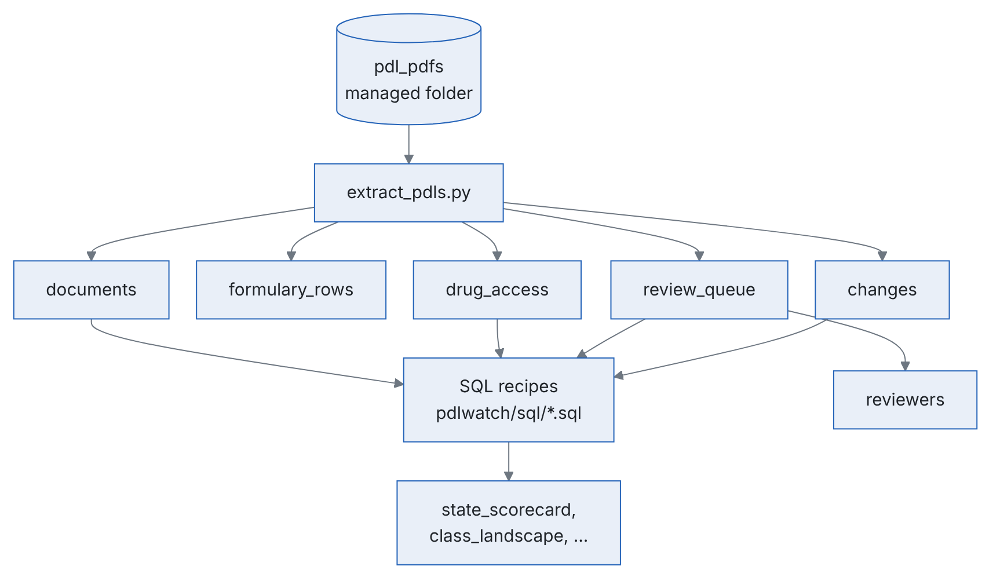

# Dataiku kit

Run PDLwatch as a Dataiku flow: PDFs land in a managed folder, a Python recipe extracts
them, and SQL recipes build the reports on a Snowflake connection. The logic lives in the tested
`pdlwatch` library; the recipe only reads the folder and writes Dataiku datasets.

## Flow

<picture>
  <source media="(prefers-color-scheme: dark)" srcset="../docs/img/dataiku_flow-dark.png">
  
</picture>

## Setup

1. **Folder:** create a managed folder `pdl_pdfs` and upload the PDFs, or point it at the share
   or bucket where the market access team saves them. `pdlwatch sync` downloads the public
   state PDLs listed in [`sources/medicaid_pdls.yaml`](../sources/medicaid_pdls.yaml) if you
   want a starting set.
2. **Code environment:** Python 3.11+ with
   `pdlwatch[ocr] @ git+https://github.com/faizanreza-cs/pdlwatch`. Scanned PDFs
   also need the `tesseract` binary on the host or in the container image the recipe runs in;
   without it, scanned pages are skipped with a warning.
3. **Python recipe:** [`recipes/extract_pdls.py`](recipes/extract_pdls.py), input `pdl_pdfs`,
   outputs `documents`, `formulary_rows`, `drug_access`, `review_queue` and `changes` on the
   Snowflake connection (set up with [`snowflake/setup.sql`](../snowflake/setup.sql)).
4. **SQL recipes:** one SQL query recipe per file in
   [`pdlwatch/sql/`](../pdlwatch/sql). They are already in Snowflake SQL; paste them
   as they are.
5. **Scenario:** trigger on a change to `pdl_pdfs`, rebuild `changes` and `review_queue`
   recursively, then email the access team when `changes` has rows for the new effective date and
   the reviewers when `review_queue` is not empty.
